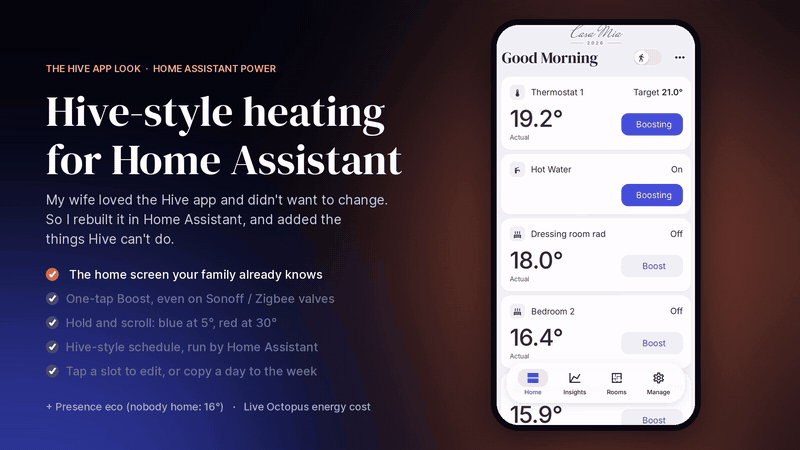
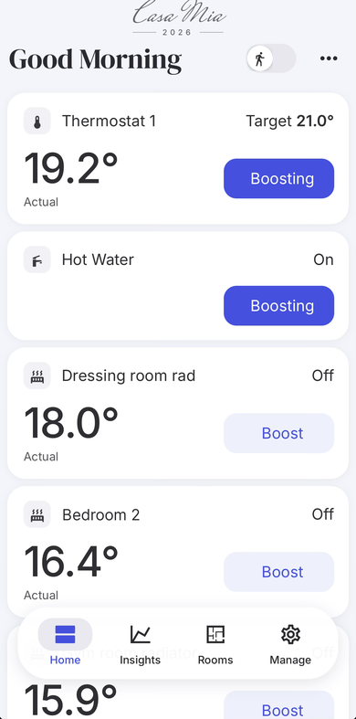
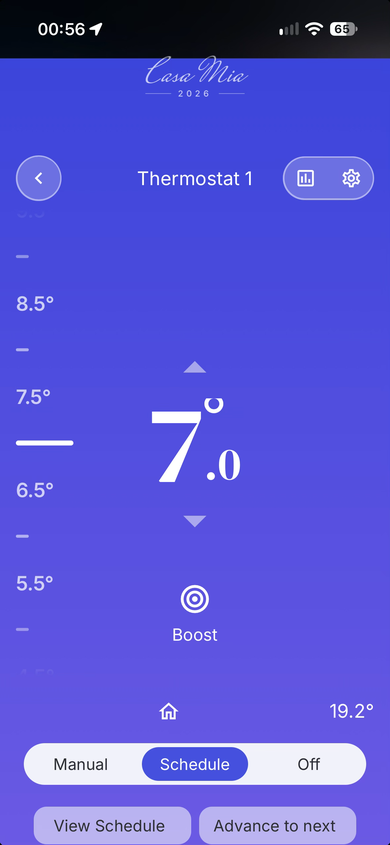
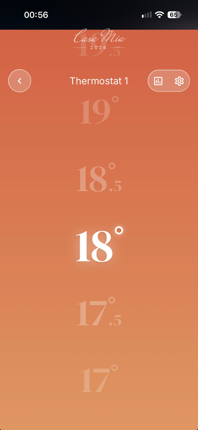
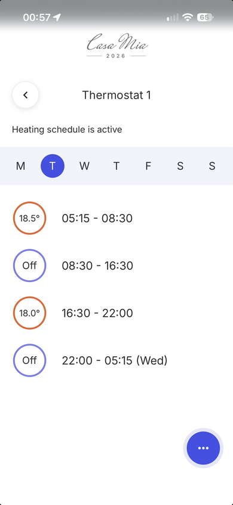

# Hive-style thermostat cards for Home Assistant

[](https://hacs.xyz/docs/faq/custom_repositories)
[](https://buymeacoffee.com/xtrendmaster)

A clean, phone-first heating dashboard for Home Assistant, inspired by the look and feel of the Hive app, with a few things the app can't do.

> **Not affiliated with, endorsed by or connected to Hive or Centrica.** "Hive" is used only to describe compatibility with the Home Assistant Hive integration.



   

## Features

- **Hive-style home screen**: big "Actual" temperature, target with a flame or tick, Boost pill on every card.
- **Thermostat page**: colour gradient that follows the target (blue at 5° through orange to red at 30°), a moving scale, up/down arrows and Manual / Schedule / Off.
- **Hold-to-scroll temperature wheel** (`custom:hive-temp-picker`): the selected number glows and the colour changes as you scroll.
- **Heating schedule in Home Assistant** (`custom:hive-schedule-card`): a Hive-style day view with an editor. Tap a slot to change start, end and temperature, add or delete periods, or copy a day to other days. It works with the [Scheduler component](https://github.com/nielsfaber/scheduler-component).
- **Advance to next** slot, like the app.
- **Boost for any radiator valve**: Hive valves use Hive's own boost; other valves (Sonoff, Aqara, Tuya…) get a Home Assistant boost that puts them back how they were when it ends.
- **Hot water** page with boost and On / Schedule / Off.
- **Insights**: temperature charts with apexcharts-card.
- **Manage**: one place for modes, away mode and device health.
- **Gentle on Hive's servers**: the wheel and arrows wait until you've finished, then send one change (never more than one every 10 seconds per thermostat). A small "Setting 19.5°" bubble shows the change is on its way.

## Requirements

Install these first, from HACS unless noted:

| Needed for | Project |
|---|---|
| Hive devices | Home Assistant **Hive** integration (built in) |
| Layout and styling | [button-card](https://github.com/custom-cards/button-card), [card-mod](https://github.com/thomasloven/lovelace-card-mod) |
| Bottom menu | [navbar-card](https://github.com/joseluis9595/lovelace-navbar-card) |
| Schedules | [Scheduler component](https://github.com/nielsfaber/scheduler-component) (integration) + [Scheduler card](https://github.com/nielsfaber/scheduler-card) |
| Charts | [apexcharts-card](https://github.com/RomRider/apexcharts-card) |
| Optional, full-screen look | [kiosk-mode](https://github.com/NemesisRE/kiosk-mode) |

## Installation

1. **Cards**: HACS → ⋮ → *Custom repositories* → add `https://github.com/xtrendmaster/hive-style-thermostat-cards`, type *Dashboard*. Install **Hive-style Thermostat Cards** and reload the browser.
2. **Package**: copy `package/hive_style_heating.yaml` to `/config/packages/`. If you don't use packages yet, add this to `configuration.yaml`:
   ```yaml
   homeassistant:
     packages: !include_dir_named packages
   ```
   Edit the entity IDs at the top of the file, then restart Home Assistant.
3. **Dashboard**: *Settings → Dashboards → Add dashboard → New dashboard from scratch*, URL `hive-heating`. Open it, then *⋮ → Edit → ⋮ → Raw configuration editor*, paste `examples/dashboard.yaml` and replace the example entity IDs with yours.
4. **Schedule**: open *Schedule → ••• → Add heating period* and build your week. Tap **Schedule** on the thermostat page to hand control to Home Assistant. Hive then stays in manual mode and follows the temperatures Home Assistant sends.

### Example entity IDs to replace

| Example | What it is |
|---|---|
| `climate.hive_thermostat` | Hive heating thermostat |
| `water_heater.hive_hot_water` | Hive hot water |
| `binary_sensor.hive_thermostat_boost` / `binary_sensor.hive_hot_water_boost` | Hive boost sensors |
| `binary_sensor.hive_hot_water_state` | Hive hot water on/off |
| `climate.bedroom_radiator` | A Hive radiator valve |
| `climate.study_radiator` + `timer.boost_study_radiator` | Any other valve and its boost timer |

## Using the cards on their own

```yaml
type: custom:hive-temp-picker
entity: climate.hive_thermostat
name: Thermostat
back_path: /hive-heating/thermostat   # where the back arrow goes
insights_path: /hive-heating/insights
min: 5
max: 30
step: 0.5
```

```yaml
type: custom:hive-schedule-card
entity: climate.hive_thermostat
title: Thermostat
tag: hive_heating                     # schedules with this tag are shown and edited
mode_entity: input_boolean.hive_ha_schedule
default_temp: 18.5
back_path: /hive-heating/thermostat
edit_path: /hive-heating/schedule-edit
```

## Radiator valves and heating single rooms

**Mix Hive and other smart valves.** Hive radiator valves work well but are expensive, and doing a whole house with them adds up. You can add cheaper Zigbee valves (Sonoff, Aqara, Tuya…) for the other rooms. On this dashboard they all sit on one screen, look the same and Boost the same way, and because everything is in Home Assistant you can use them in your own automations too.

**How a single room heats.** A radiator valve only opens or closes; the boiler fires only when the main thermostat asks for heat. So boosting one valve while the heating is off on the schedule warms that room only if the boiler is running. A "rooms call the boiler" option, which turns the main thermostat up for a while and then puts it back, is being tested.

**While the boiler runs:**
- Smart valves set lower than their room's temperature stay closed, so those rooms don't heat.
- Radiators **without** a smart valve heat up as normal, because nothing tells them to stay closed (a normal TRV only shuts once its room is already warm). For real room-by-room control, fit smart valves to the rooms you use most first; the rest can come later.
- Most systems have a bypass valve or a towel rail without a TRV, so the boiler always has somewhere to send the water when nearly every valve is closed. If you're not sure about yours, ask a heating engineer when you fit smart valves.

## Good to know

- **"Off" in a schedule is 7°**, Hive's frost setting, so the boiler still protects the house.
- **Don't use Hive's own schedule at the same time.** If someone selects Schedule in the Hive app, the two schedules will fight. Use the dashboard's Schedule button instead.
- **Hive's servers block bursts of changes.** Several temperature changes within a few seconds make Hive answer with HTTP 403 "Token expired or forbidden" for a few minutes, even though nothing is wrong with your login. The cards' write gate prevents this. If you add your own buttons, use `tap_action: {action: fire-dom-event, hive_nudge: {entity_id: climate.x, delta: 0.5}}` (or `hive_set: {entity_id, temperature}`) rather than calling `climate.set_temperature` on every tap. If you do see a 403, wait 5–10 minutes before changing anything; don't delete and re-add the integration.
- **Hive needs the internet.** Every change goes through Hive's cloud, so a DNS or broadband blip makes a change fail. Locally controlled valves (Zigbee via ZHA or Zigbee2MQTT) aren't affected.
- **Hive radiator valves**: the integration's "boost off" doesn't work on them, so the package cancels a valve boost by restoring a snapshot taken when the boost started. If Home Assistant restarts mid-boost, the snapshot is lost and the valve turns off.
- **Faint boxes behind titles or empty space?** A "frosted glass" style Home Assistant theme draws a box around every card. The dashboard does its own light and dark look, so set your profile's **Theme** to **Use default theme** (tap your name at the bottom of the sidebar).
- The cards save the whole day back to Scheduler when you edit it. Editing one day of a shared schedule (e.g. Tue–Fri) splits that day into its own schedule.

## Changelog

- **1.3.1**: the schedule editor accepts any minute (not only 15-minute steps). There's no limit on periods per day.
- **1.3.0**: the scroll wheel automatically shows the room's photo if the radiator's Area has a picture (Settings > Areas). `photo:` still overrides it; `area_photo: false` turns it off.
- **1.2.0**: `hive-temp-picker` takes an optional `photo:` (image URL) shown softly behind the colour.
- **1.1.0**: write gate. The wheel and arrows batch changes so Hive doesn't block them; "Setting…" bubble; the wheel never sends a value you didn't choose (e.g. after a reconnect).
- **1.0.0**: first release.

## Support

This project is free. If it saves you time, you can [buy me a coffee ☕](https://buymeacoffee.com/xtrendmaster). Bugs and ideas go in the **Issues** tab.

## Credits

Built on the work of button-card, card-mod, navbar-card, Scheduler component and card, and apexcharts-card. Fonts: [DM Serif Display](https://fonts.google.com/specimen/DM+Serif+Display) and [Inter](https://fonts.google.com/specimen/Inter) (SIL Open Font License).

## Licence

[MIT](LICENSE)
